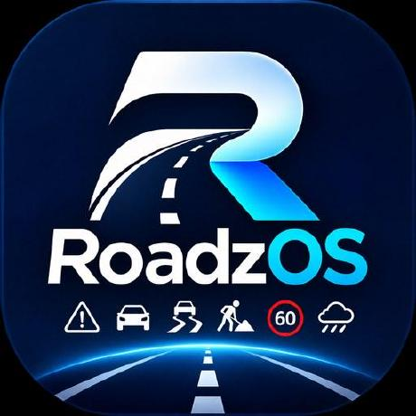
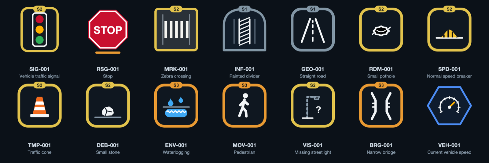
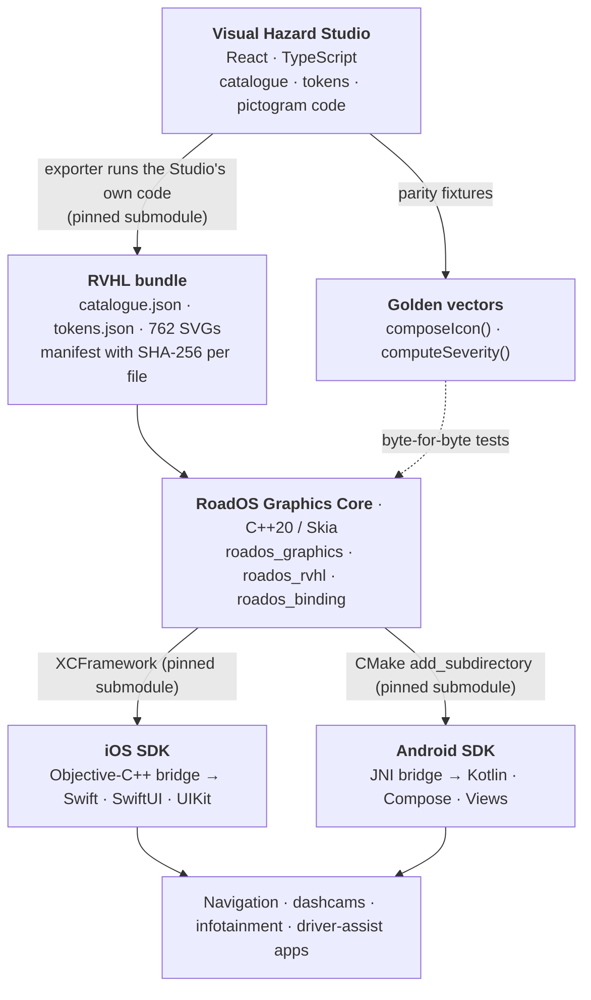
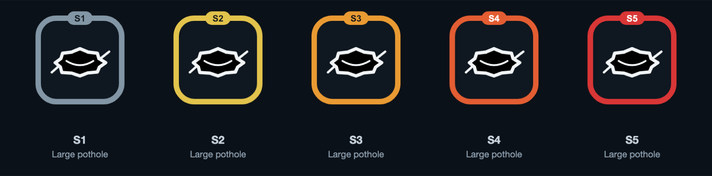
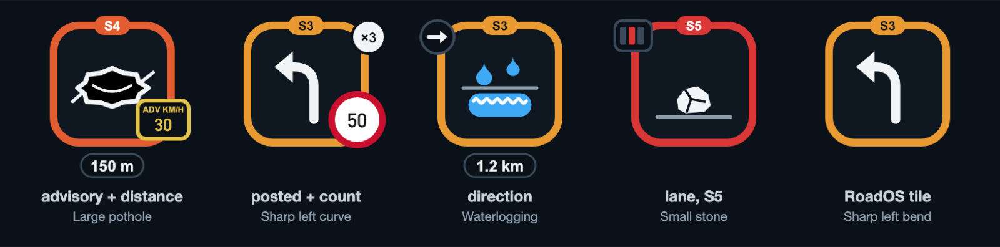
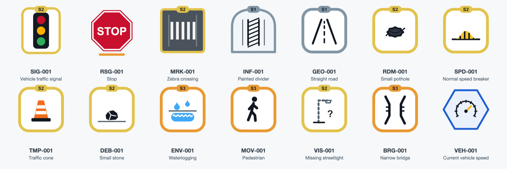
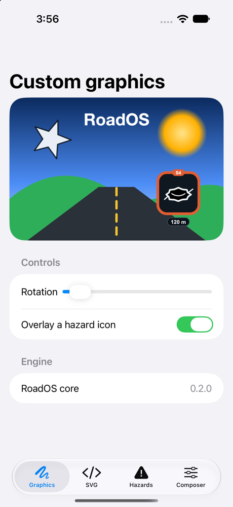
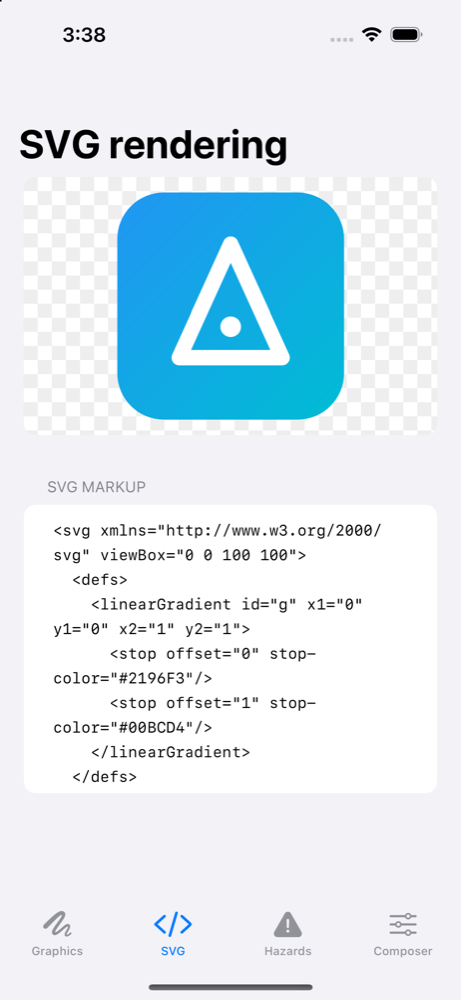
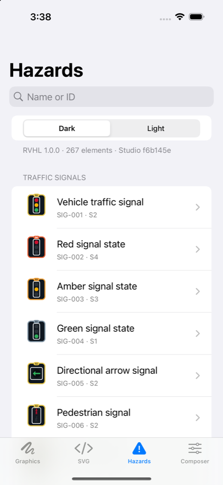
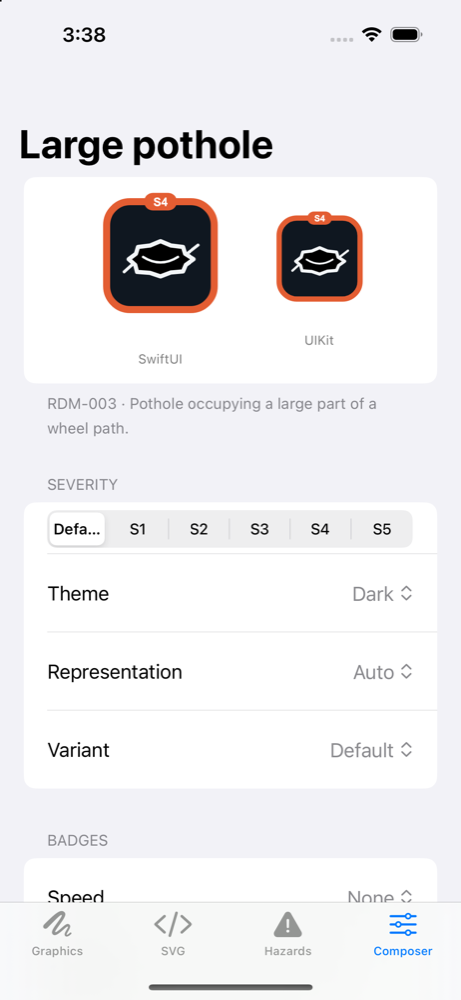

<p align="center">
  
</p>

<h1 align="center">RoadzOS</h1>

<p align="center">
  <b>One graphics engine. Native libraries for every platform. One visual language for the road.</b><br>
  An open graphics ecosystem for intelligent mobility: a C++/Skia rendering engine, a road-hazard visual language,
  and native SDKs for iOS and Android.
</p>

<p align="center">
  <a href="https://github.com/RoadzOS/roados-graphics-core">Graphics Core</a> ·
  <a href="https://github.com/RoadzOS/roados-ios-sdk">iOS SDK</a> ·
  <a href="https://github.com/RoadzOS/roados-android-sdk">Android SDK</a> ·
  <a href="https://github.com/RoadzOS/roados-visual-hazard-studio">Visual Hazard Studio</a>
</p>

<p align="center">
  
  <br><sub>One element from each of the 14 RVHL families, rendered by RoadOS Graphics Core (<code>examples/hazard_gallery</code>).</sub>
</p>

---

## Vision

Road signs follow official standards. Many of the dangers on real roads don't: potholes, unmarked speed breakers, animals, flooding, debris. Every navigation app, dashcam and in-car screen draws these differently, if it shows them at all.

RoadzOS aims to give these hazards **one consistent visual language**. That language is drawn by **one rendering engine** that runs the same way in a phone app, an infotainment system or a web tool.

* **RVHL** (RoadOS Visual Hazard Language) defines what each road element looks like. It covers 267 elements in 14 families, with severity levels, speed badges and distance labels.
* **RoadOS Graphics Core** is the only renderer. It is a general-purpose C++20 vector graphics library built on Skia, and it also renders RVHL.
* The **native SDKs** bring the same engine to iOS and Android with idiomatic APIs (Swift/SwiftUI/UIKit and Kotlin/Compose/Views). Neither SDK has rendering code of its own.

> RVHL is a RoadzOS design proposal. It is **not** ISO-certified or approved by any government or standards body. Severity levels and advisory speeds are proposals, never legal limits.

## Repositories

| Repository | What it is | Technology | Start here |
|---|---|---|---|
| [**roados-visual-hazard-studio**](https://github.com/RoadzOS/roados-visual-hazard-studio) | The **source of truth** for RVHL. A web studio to browse, compose, preview and export the 267 catalogue elements. | React 18 · TypeScript · Vite · Zod | [README](https://github.com/RoadzOS/roados-visual-hazard-studio#readme) · [RVHL spec](https://github.com/RoadzOS/roados-visual-hazard-studio/blob/main/src/docs/rvhl-spec.md) |
| [**roados-graphics-core**](https://github.com/RoadzOS/roados-graphics-core) | The **rendering engine**. General vector graphics, SVG, the RVHL catalogue, hazard composition, the severity engine, and the binding layer the SDKs use. | C++20 · Skia m158 · CMake · GoogleTest | [README](https://github.com/RoadzOS/roados-graphics-core#readme) · [Build guide](https://github.com/RoadzOS/roados-graphics-core/blob/main/docs/build/README.md) |
| [**roados-ios-sdk**](https://github.com/RoadzOS/roados-ios-sdk) | **iOS SDK.** Swift API, SwiftUI `RoadOSIcon` and `RoadOSCanvas`, and the UIKit `RoadOSHazardView`. | Swift 6 · Objective-C++ · SwiftPM · XCFramework | [README](https://github.com/RoadzOS/roados-ios-sdk#readme) · [Sample app](https://github.com/RoadzOS/roados-ios-sdk/tree/main/Examples/RoadOSDemo) |
| [**roados-android-sdk**](https://github.com/RoadzOS/roados-android-sdk) | **Android SDK.** Kotlin API, Compose `RoadOSIcon` and `RoadOSCanvas`, and the `RoadOSHazardView` Android View. | Kotlin · JNI · NDK · CMake · Gradle · Compose | [README](https://github.com/RoadzOS/roados-android-sdk#readme) · [Sample app](https://github.com/RoadzOS/roados-android-sdk/tree/main/sample) |

Each repository has its own detailed technical documentation. This page gives the big picture.

## How it fits together



**The rules behind the architecture:**

1. **One renderer.** Every pixel on every platform comes from RoadOS Graphics Core. The SDKs only convert values. Styles, scenes, hazard options and the catalogue cache are implemented once, in C++ (`roados::binding`).
2. **The Studio is canonical.** Its pictograms are TypeScript functions, not files. The core does not redraw them: an exporter **runs the Studio's own code** at a pinned commit and records a SHA-256 for every generated file. `export_rvhl.sh --check` fails if the bundle drifts.
3. **Parity is tested, not assumed.** The C++ composition is a port of the Studio's `composeIcon()`. It matches the Studio's output **byte for byte** on 1,193 golden cases. The severity engine matches on 3,204 cases.
4. **Pinned versions.** Each SDK pins the core as a git submodule, and the core pins the Studio and a specific Skia commit. An update moves forward one reviewed commit at a time.

**How a Studio change reaches the apps:** bump the Studio submodule in the core → run `scripts/export_rvhl.sh` and `--golden` → run the core tests → bump the core submodule in each SDK → rebuild.

## Technology stack

| Layer | Technologies |
|---|---|
| Design system | React 18, TypeScript, Vite, Tailwind CSS, Zod schemas, JSON design tokens |
| Rendering engine | C++20, Skia m158 (built from source: CPU raster, SVG module, PNG), CMake presets, GoogleTest, nlohmann/json |
| iOS | Swift 6 (strict concurrency, typed throws), Objective-C++, Swift Package Manager, XCFramework (iOS, Simulator, macOS arm64), SwiftUI, UIKit |
| Android | Kotlin, JNI, Android NDK r30, CMake, Gradle 9 / AGP 9, Jetpack Compose, Android Views, coroutines |
| Quality | Pixel and Chrome-parity visual regression, golden vectors generated from the Studio, SHA-256 bundle checks, host-JVM JNI tests |

## What each project can do

<details open>
<summary><b>RoadOS Visual Hazard Studio</b>: define and preview the visual language</summary>

* Catalogue of **267 road elements in 14 families**: signals, signs, markings, infrastructure, geometry, road damage, speed control, temporary works, debris, environment, moving hazards, visibility, bridges and vehicle context.
* **Icon Studio**: frames, severity (S1–S5), speed badges, distance labels, light and dark themes.
* Dashboard, catalogue browser, entry details, map and corridor previews, severity and speed systems, design tokens, standards references.
* **Export Centre**: SVG and PNG at several sizes, plus ZIP bundles with manifests.

| Dashboard | Catalogue | Icon Studio |
|---|---|---|
|  |  |  |
| **Entry detail** | **Map preview** | **Corridor preview** |
|  |  |  |

</details>

<details open>
<summary><b>RoadOS Graphics Core</b>: the engine</summary>

* **General graphics, independent of RVHL:**
  * shapes: circle, ellipse, rectangles, polygons, lines and polylines;
  * paths: SVG path data and cubic and quadratic Béziers;
  * paint: solid colours, linear and radial gradients, dashes, blend modes;
  * text with CSS font fallback, images, groups, layers, clips and transforms.
* **Output:** PNG, raw RGBA buffers (including caller-owned memory) and SVG, at any scale.
* **SVG rendering** through Skia's SVG module, with a documented text-baseline fix. Every RVHL pictogram renders.
* **RVHL:**
  * `rvhl::Library` checks versions and file hashes and looks entries up by ID;
  * `rvhl::Hazard` composes icons with toggleable, reorderable layers and custom overlays;
  * the severity and advisory-speed engine.
* **Error handling:** an exception-free `Result<T>` API with no Skia types in public headers. Colour literals are checked at compile time.

<p align="center">
  <br>
  <sub>The same element at severities S1–S5.</sub>
</p>
<p align="center">
  <br>
  <sub>Composition: advisory and posted speed, count, direction, lane and distance badges, plus a convention sign shown as a RoadOS tile.</sub>
</p>
<p align="center">
  <br>
  <sub>Light theme.</sub>
</p>

</details>

<details open>
<summary><b>iOS SDK</b>: Swift, SwiftUI, UIKit</summary>

```swift
let graphics = RoadOSGraphics.create { $0.width = 512; $0.height = 512 }
graphics.circle { $0.centerX = 100; $0.centerY = 100; $0.radius = 40; $0.fill = "#2196F3" }
let image = try graphics.render(scale: 2)

RoadOSIcon(hazardId: "RDM-003", severity: .high)   // SwiftUI
    .frame(width: 64, height: 64)
```

| Custom graphics | SVG rendering | Hazard catalogue | Composer (SwiftUI and UIKit) |
|---|---|---|---|
|  |  |  |  |

<sub>The <a href="https://github.com/RoadzOS/roados-ios-sdk/tree/main/Examples/RoadOSDemo">RoadOSDemo</a> sample running in the iOS Simulator (iPhone 18 Pro on iOS 27.2, and iPhone 15 Pro on iOS 17.2).</sub>

</details>

<details open>
<summary><b>Android SDK</b>: Kotlin, Compose, Views</summary>

```kotlin
val graphics = RoadOSGraphics.create { width = 512; height = 512 }
graphics.circle { centerX = 100f; centerY = 100f; radius = 40f; fill = "#2196F3" }
val bitmap = graphics.renderBitmap(scale = 2f)

RoadOSIcon(hazardId = "RDM-003", severity = HazardSeverity.HIGH, size = 64.dp)   // Compose
```

The sample app has the same four screens as iOS. Android screenshots will be added after the first emulator run (see [Status](#project-status)).

</details>

## Getting started

| I want to… | Go to |
|---|---|
| Understand the visual language | [Studio README](https://github.com/RoadzOS/roados-visual-hazard-studio#readme) and the [RVHL specification](https://github.com/RoadzOS/roados-visual-hazard-studio/blob/main/src/docs/rvhl-spec.md) |
| Run the Studio locally | `npm ci && npm run dev` in [roados-visual-hazard-studio](https://github.com/RoadzOS/roados-visual-hazard-studio) |
| Use the C++ engine | [Core quick start](https://github.com/RoadzOS/roados-graphics-core#quick-start) and the [examples](https://github.com/RoadzOS/roados-graphics-core/tree/main/examples) |
| Build an iOS app | [iOS SDK installation](https://github.com/RoadzOS/roados-ios-sdk#installation-local) and [RoadOSDemo](https://github.com/RoadzOS/roados-ios-sdk/tree/main/Examples/RoadOSDemo) |
| Build an Android app | [Android SDK build](https://github.com/RoadzOS/roados-android-sdk#build) and the [sample](https://github.com/RoadzOS/roados-android-sdk/tree/main/sample) |
| Read the design decisions | [Discovery](https://github.com/RoadzOS/roados-graphics-core/blob/main/docs/architecture/00-discovery.md) and [Architecture ADRs](https://github.com/RoadzOS/roados-graphics-core/blob/main/docs/architecture/01-architecture.md) |

```bash
# The engine (macOS or Linux)
git clone --recurse-submodules https://github.com/RoadzOS/roados-graphics-core.git
cd roados-graphics-core
scripts/bootstrap_skia.sh Release          # Skia from source, pinned
cmake --preset macos-debug && cmake --build --preset macos-debug && ctest --preset macos-debug
build/macos-debug/examples/hazard_gallery assets/rvhl out/   # renders the galleries on this page
```

**Hazard identifiers.** Look elements up by ID, e.g. `RDM-003` (Large pothole). `pothole` is a pictogram key that nine entries share, so the APIs return an error that lists the candidate IDs.

## Project status

| Project | Status |
|---|---|
| Visual Hazard Studio | RVHL 1.0: 267 entries, 14 families, catalogue validation passes |
| Graphics Core 0.2.0 | 132/132 tests pass on macOS arm64 (Debug and Release). Linux and Windows builds aren't verified yet. |
| iOS SDK 0.1.0 | 16/16 tests pass on macOS and the iOS Simulator. The sample app runs on iOS 17.2 and 27.2. Not yet tested on a physical device. |
| Android SDK 0.1.0 | The JNI bridge passes 12/12 tests on a host JVM against the real engine. **The Gradle and NDK build, Kotlin, Compose and the sample app haven't run yet.** |

No SDK has been published to a package registry yet. Use them from source as each README describes.

## Roadmap

- [ ] **Android:** first Gradle/NDK build, instrumentation tests on an emulator, sample app screenshots
- [ ] **Cross-platform visual consistency:** shared fixture set rendered by C++, iOS and Android, with pixel-diff tolerances
- [ ] **Benchmarks:** render time and memory for shapes, SVG and hazard compositions on each platform
- [ ] **CI:** core on macOS and Linux, Studio parity (`export_rvhl.sh --check`), iOS and Android builds
- [ ] Bundled OFL fonts, so text looks the same on every platform
- [ ] Severity and advisory-speed APIs in Swift and Kotlin
- [ ] GPU backends (Metal and Vulkan) behind the same API
- [ ] Linux and Windows builds of the core
- [ ] Releases: versioned RVHL bundles, a prebuilt XCFramework, an AAR
- [ ] Licences for all repositories (pending)

## Contributing

Contributions are welcome. Please read [CONTRIBUTING.md](https://github.com/RoadzOS/.github/blob/main/CONTRIBUTING.md) first. In short:

* **Visual changes** (catalogue, pictograms, tokens) belong in the **Studio**. The other repositories inherit them through the pinned bundle and never edit generated assets by hand.
* **Rendering changes** belong in **Graphics Core**, with tests. The SDKs should only marshal values.
* Each change must keep the Studio parity tests and the SDK test suites passing, and report results honestly.

<p align="center"><sub>RoadzOS · open graphics for intelligent mobility</sub></p>
